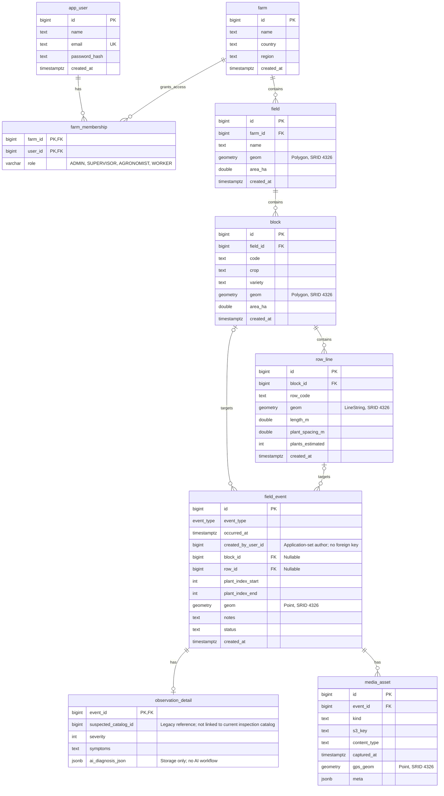
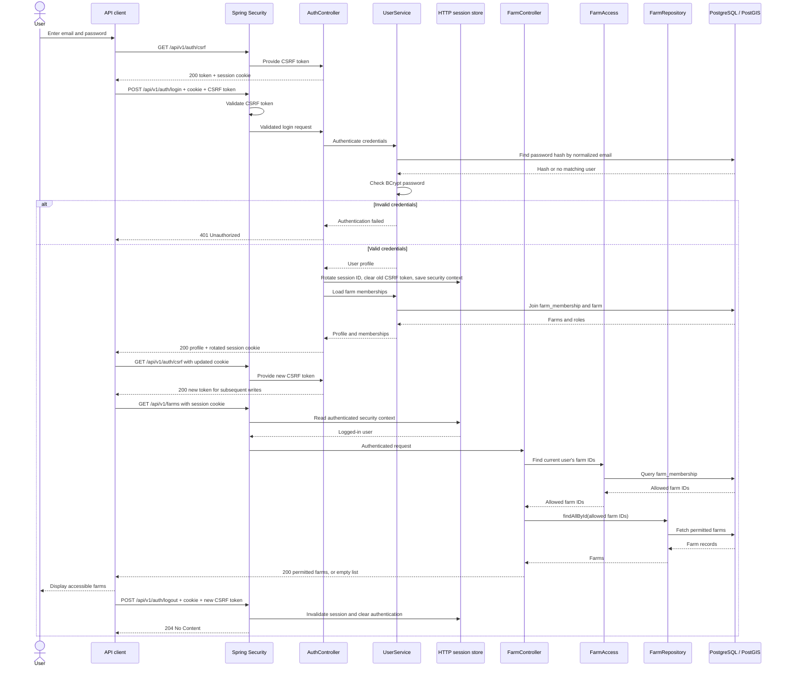
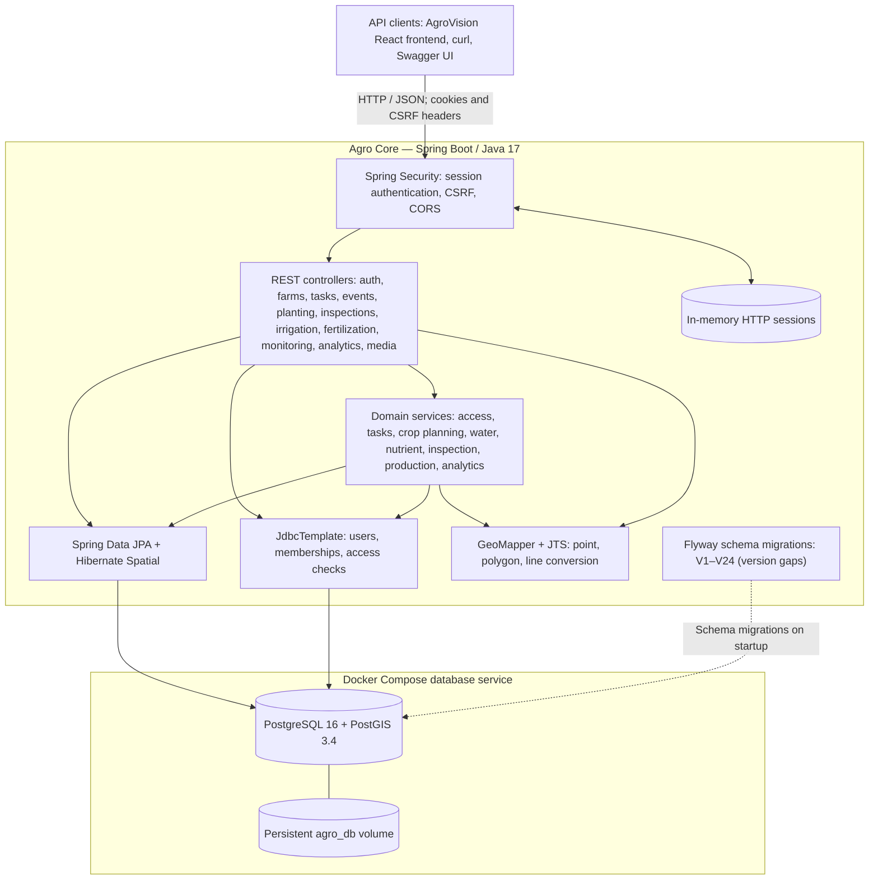
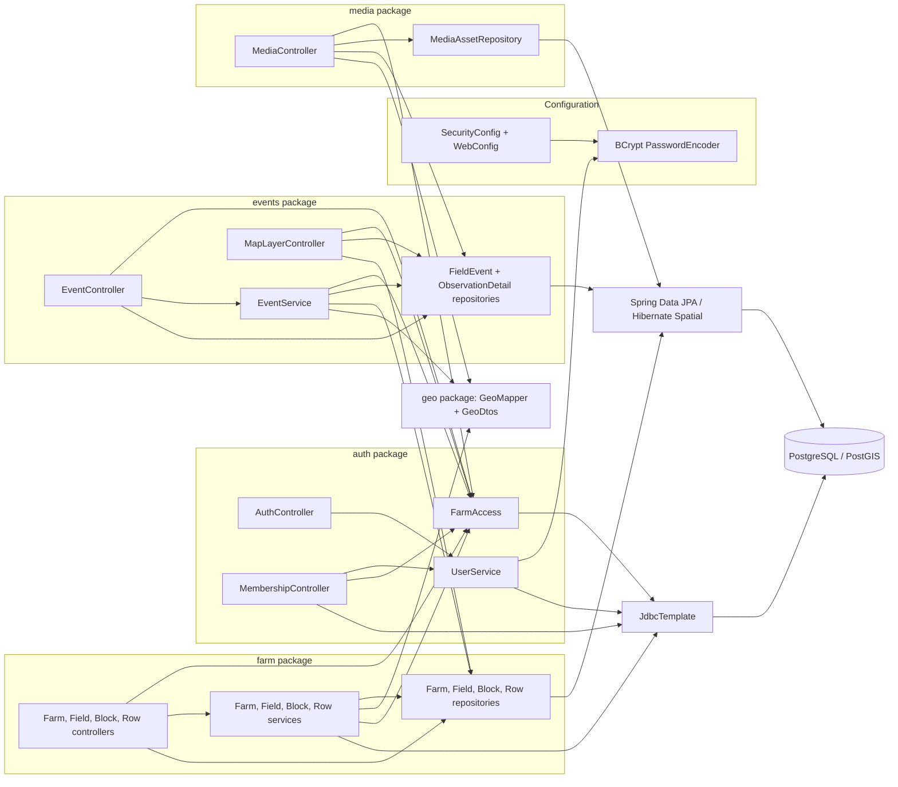

# Agro Core and AgroVision

Agro Core is a farm-scoped agricultural operations API, and AgroVision is its
Spanish-language web interface. Together they cover farm setup, field work,
crop cycles, irrigation, nutrient management, inspections, production records,
and agricultural maps.

This repository contains an MVP with a local demonstration mode and a
server-backed mode. Demo data is visibly labeled and isolated from real farm
records. The system records agricultural workflows and technical reviews; it
does not claim to automate agronomic diagnosis, prescriptions, or decisions.

## Project handbook

Open the [Agro Core project handbook](docs/project-handbook/index.html) for a
searchable, chapter-based view of the project overview, architecture diagrams,
requirements, implementation details, agronomic and module guides, frontend
workflows, and operations notes. Every guide has its own page and table of
contents, and includes the full contents of the maintained Markdown guide.
After updating those guides, refresh the handbook with
`python3 scripts/generate_project_handbook.py` from the repository root.

## Module guides

- **Fertilización:** análisis de laboratorio, interpretación preliminar
  revisable, perfiles, catálogo de productos, planes aprobados únicos o
  recurrentes, tareas por ocurrencia, aplicaciones parciales con fotos y
  seguimiento técnico. [Proceso y límites](docs/fertilization.md).
- **Water management:** irrigation sectors, moisture monitoring, schedules,
  execution, water usage, sources, quality, infrastructure, balances,
  maintenance, and sensor checks. [Implementation details](docs/water-management.md).

## Current implementation snapshot

| Area | Available now | Important boundary |
| --- | --- | --- |
| Farm access | Registration, session login, farm creation, per-farm `ADMIN`, `SUPERVISOR`, `AGRONOMIST`, and `WORKER` roles. | Password recovery, email verification, and membership removal are not implemented. |
| Farm structure | Farm → field → block → row, with SRID 4326 polygons and row lines. | Measurements are supplied or estimated values; there are no update endpoints for fields, blocks, or rows. |
| Work tasks | Persistent task assignment and status flow for field/block work, blockers, notes, review, and approval. | No row targeting, rescheduling, structured execution quantities, task evidence, or offline synchronization. |
| Planting | Catalogs, crop cycles, site assessments, planting-material lots, approved plans, execution, establishment checks, stage history, and regional calendars. | Calendar/stage automation, complete catalog lifecycle, and cycle audit history remain open gaps. |
| Irrigation | Moisture records, thresholds, one-time plans, daily/weekly recurring schedules, execution, water records, and sensor checks. | No automatic valves, weather optimization, external telemetry gateway, or complete hydraulic map. |
| Fertilization | Soil/foliar analysis, configurable profiles, provisional interpretation, agronomist review, product catalogs, approved recurring/one-time plans, applications, and follow-up. | No fertilizer prescription, inventory, cost management, or lab integration. |
| Inspections and prevention | Managed pest/disease catalog, inspections, review, follow-ups, treatments, manual preventive assignments, and evidence. | Records are not a verified diagnosis; risk-triggered treatment workflows are not implemented. |
| Harvest | Structured, editable `HARVEST` records linked to field/block/row and crop cycle, with quantities, units, quality, rejection, and variance. | Harvest planning and bunch-level traceability remain open gaps. |
| Sensors and analytics | Sensor/readings APIs, configurable threshold alerts, dashboard and map summaries, and water-use analytics. | No physical IoT gateway or predictive recommendations. |
| Photos | Authenticated JPEG/PNG upload, view, and download for events and inspections/treatments. | Photo bytes are stored in PostgreSQL; S3 uploads and presigned URLs are not implemented. |

See [system requirements](docs/system-requirements.md) for the full FR-01–FR-29
and NFR-01–NFR-16 status matrix, and the module documents below for workflow
details and evidence.

## AgroVision frontend

The React / TypeScript / Vite frontend includes responsive desktop and mobile
layouts, a sidebar, global view search, farm selection, and these screens:

- Dashboard with farm metrics, recent activity, interactive map, and charts.
- Daily work with filtering, farm-member assignment, field/block targeting,
  creation, execution, blocking, review, and approval persisted in PostgreSQL.
- Farm maps with interactive fields, blocks, and rows, zoom, filters, layer
  controls, and health, moisture, nutrient, and disease-observation views. Demo
  layers are illustrative. Real mode draws stored field/block polygons and row
  lines over OpenStreetMap, with Esri World Imagery satellite and hybrid options.
- Fields, blocks, and rows with creation forms, parent filters, and confirmed
  deletion according to the current user's permissions.
- Planting cycles, site/material approvals, planting execution, establishment, and
  regional planting calendars.
- Irrigation sectors, moisture readings, recurring scheduling, execution, water
  administration, and usage reports.
- Soil/foliar analyses, nutrient profiles, approved fertilizer plans, and
  application follow-up.
- Pest/disease inspections, preventive assignments, treatments, and event history.
- Structured crop-cycle harvest records alongside legacy harvest events.
- Event creation and detail, authenticated photo uploads, legacy media references,
  filtered CSV export, and authorized deletion.
- Agronomic center, account details, farm information, and team role assignment.
- Registration and login with session cookies and automatic CSRF handling.

### Nutrient management coverage

The current fertilization workflow covers the three core nutrient-management
requirements at MVP level:

| Capability | Current coverage | Status |
| --- | --- | --- |
| Track soil nutrient levels | Soil and foliar analyses record N, P, K, pH, organic matter, Ca, Mg, S, B, and Zn with units, methods, laboratory, date, block, reference, and report evidence. | Implemented |
| Identify deficiencies | Compatible banana/plantain soil results receive a provisional `Low`, `Adequate`, `High`, or `Unknown` interpretation with the matched range and explanation. | Partial: technical review remains required |
| Monitor fertilizer applications | Approved plans and application records support catalog products, doses, units, quantities, dates, recurrence, occurrence tasks, target coverage, lots, evidence, partial applications, totals, and follow-up. | Implemented |

Interpretations are preliminary and do not generate fertilizer recommendations,
doses, or prescriptions. Configurable farm/crop/variety profiles and persisted
agronomist review are implemented; method-aware validation, confidence scoring,
and inventory/cost controls remain open gaps. See [fertilization workflow](docs/fertilization.md)
for the operational limits, API endpoints, and frontend screens.

### Run the frontend

Requires Node.js 22.18+ and npm. From the repository root:

```bash
cd frontend
npm ci
npm run dev
```

Open http://127.0.0.1:5173/#harvest to open the structured Cosecha screen directly. The app starts in a visibly labeled demonstration that
works without the Java API. Use **Conectar mi finca** to register or log in to the
real backend. API requests are proxied from `/api` to `http://localhost:8080`;
override the target with `AGRO_API_URL` when launching Vite if needed.

Demo changes are stored in this browser under `agrovision.*` local-storage keys.
Real authentication uses HTTP-only server session cookies, not local-storage
tokens. The real mode does not substitute demo tasks, sensors, yields, or AI
results when the backend lacks those features. The aerial demo map is an
AI-generated illustration, not satellite imagery of an actual farm.

```bash
npm test
npm run build
npx playwright install chromium
npm run test:e2e
```

The production build is written to `frontend/dist`. Production hosting needs an
`/api` reverse proxy to the backend and same-site session cookies. The Vite
development proxy is not included in the production build. See
[frontend/README.md](frontend/README.md) for screens, limitations, and testing.

## Implemented features

### Farm, field, block, and row management

The location hierarchy is **Farm → Field → Block → Row**.

| Resource | Operations | Stored information | List filters |
| --- | --- | --- | --- |
| Farm | Create, list, retrieve by ID, delete | Name, country, region, creation timestamp | Current user's farm memberships |
| Field | Create, list, retrieve by ID, delete | Parent farm, name, polygon boundary, supplied area in hectares, creation timestamp | `farmId` |
| Block | Create, list, retrieve by ID, delete | Parent field, code, crop (defaults to banana), variety, polygon boundary, supplied area in hectares, creation timestamp | `fieldId` |
| Row | Create, list, retrieve by ID, delete | Parent block, row code, geographic line, supplied length in meters, plant spacing (defaults to 2 meters), estimated plant count, creation timestamp | `blockId` |

Lists are restricted to farms the user belongs to. Block codes are unique within
a field; row codes are unique within a block. Areas, lengths, and estimated plant
counts are supplied by the client rather than calculated automatically. There are
no update endpoints for these resources.

### Agricultural events and work history

- Create, search, retrieve by ID, and delete agricultural events.
- Record occurrence time, notes, optional GPS location, and creation timestamp.
- Link an event to a block, a row, or both. When both are supplied, the row must
  belong to that block.
- Identify an affected plant range using `plantIndexStart` and `plantIndexEnd`;
  individual plants are not separate managed records.
- Record the authenticated user as the event author.
- Search using optional `farmId`, `blockId`, `rowId`, `eventType`, `from`, and `to`
  filters. Date bounds are inclusive and use timestamps such as
  `2026-10-16T00:00:00Z`.

Supported event types:

| Type | Purpose |
| --- | --- |
| `SCOUTING_OBSERVATION` | Record crop inspections and suspected pest/disease observations |
| `TREATMENT_APPLICATION` | Record that a treatment was applied |
| `FERTILIZER_APPLICATION` | Record that fertilization occurred |
| `IRRIGATION_EVENT` | Record that watering/irrigation occurred |
| `HANDLING_EVENT` | Record crop handling activities |
| `SOIL_SAMPLE` | Record that a soil sample was taken |
| `HARVEST_EVENT` | Record that harvesting occurred |

These event records are separate from scheduled work tasks and preserve the activity
history. Structured crop monitoring data is stored through the monitoring-record API
described below. Events default to status `OPEN`, with no status-transition endpoint.

### Scouting observations

- Attach `suspectedCatalogId`, `severity`, and `symptoms` to a scouting event when
  an observation payload is provided.
- Associate the observation with a block, row, or plant range through its event.
- Store a suspected catalog reference; the dedicated inspection workflow also
  uses the managed phytosanitary catalog and only active problems can be used
  for new inspections.

The database includes an `ai_diagnosis_json` column, but there is no implemented
AI diagnosis service or API workflow. Observation details are persisted on event
creation; there is no separate observation read/update endpoint.

### Disease map layer

- Return a GeoJSON `FeatureCollection` containing row `LineString` geometries.
- Include `rowId`, `rowCode`, maximum severity, observation count, and latest
  observation timestamp for each returned row.
- Filter by optional `farmId`, `from`, and `to`, within the user's farm access.
- Include rows with associated scouting observation details; this is an
  observation-based summary, not a confirmed disease diagnosis or prediction.

The backend supplies map data; it does not include a map viewer.

### Media records

- Register media references against an existing event.
- Store media kind, S3 object key, content type, capture timestamp, optional GPS
  location, and JSON metadata.
- List media records by `eventId`.

The legacy `/media` module stores references and metadata. Actual JPEG/PNG photos
are uploaded, viewed, and downloaded through `/photos`, described below. S3 client
integration and presigned URLs are not implemented. There are no media-reference
update or delete endpoints.

### Fotos de eventos, inspecciones y tratamientos

Desde el detalle de un evento o inspección se pueden elegir fotos, usar la opción
de cámara del dispositivo, ver miniaturas, ampliar y descargar las imágenes.
En inspecciones se puede seleccionar un tratamiento como destino de la foto.
Primero se guarda el registro y después se adjuntan las fotos desde su detalle.

Las fotos reales se guardan como datos binarios en PostgreSQL mediante la migración
V8; no requieren S3 ni un directorio compartido de archivos. Los respaldos de la
base deben incluir `photo_asset`. Las claves S3 anteriores siguen disponibles como
referencias externas y no se convierten automáticamente en fotos cargadas.

| Endpoint | Comportamiento |
| --- | --- |
| `POST /api/v1/photos` | Multipart con `file` y `eventId` o `inspectionId`; `treatmentId` opcional para inspecciones |
| `GET /api/v1/photos` | Lista metadatos según el mismo destino, sin devolver los bytes |
| `GET /api/v1/photos/{id}/content` | Imagen autenticada; `?download=true` fuerza descarga |

La carga admite JPEG y PNG de hasta 10 MB y 24 megapíxeles; hasta 10 fotos por
selección, enviadas individualmente. El navegador aplica la orientación de la
imagen y la prepara para carga. El servidor verifica el contenido real y las
dimensiones, decodifica y vuelve a codificar la imagen sin metadatos originales.
Se conserva el nombre del archivo saneado, formato, tamaño, autor y fecha de carga.
Cada carga, consulta y descarga exige sesión y pertenencia a la finca; las cargas
usan CSRF. Las respuestas de imagen tienen `no-store` y `nosniff`.

Una inspección anulada conserva sus fotos consultables, pero no admite más cargas.
Al eliminar un evento se eliminan sus fotos por cascada. El modo demo guarda los
blobs en IndexedDB, separados de los datos reales, conserva las fotos al recargar
y las limpia al restablecer la demostración. Al eliminar eventos demo también se
eliminan sus fotos. Las cargas fallidas muestran error y conservan las fotos que
ya se guardaron en una selección múltiple.

### Authentication and authorization

- Register users and log in/out using HTTP sessions.
- Retrieve the current user's profile and farm memberships.
- Store BCrypt password hashes and normalized email addresses.
- Protect state-changing requests with CSRF tokens; rotate session IDs and CSRF
  tokens at login.
- Assign `ADMIN`, `SUPERVISOR`, `AGRONOMIST`, and `WORKER` roles independently for each farm.
- Automatically give farm creators the administrator role on their new farm.
- Let administrators add registered users to their farm or change their roles.
- Restrict farm resources, events, media, and map results to farm members.

See the permissions table and onboarding examples below for the complete flow.

### Geospatial storage and infrastructure

- PostgreSQL/PostGIS storage with spatial indexes and SRID 4326 coordinates.
- Point, polygon, and line input DTOs, with automatic closure of polygon rings;
  only the outer polygon ring is supported.
- Spring Data JPA persistence, Hibernate Spatial, and JTS geometry conversion.
- Flyway migrations evolve the schema from core farm/identity tables through
  planting, task, irrigation, fertilization, inspections, photos, and production
  workflows (currently through V24, with version gaps).
- Basic request validation for required fields and authentication inputs.
- Swagger/OpenAPI documentation and interactive API exploration.
- Spring Boot Actuator health endpoint at `/actuator/health`.
- Configurable browser CORS origins and session cookie settings.
- Docker Compose database setup with persistent database storage.
- Gradle wrapper and automated authentication, permission, membership, and
  application startup tests.

## Functional requirements

Functional requirements describe **what users can do and what the system must
do in response**. For example, a worker signs in, sees their assigned work, and
records its completion. The statuses below distinguish current behavior from work
that still needs development:

- **Implemented:** available in the current backend.
- **In progress:** the core workflow exists, but important capabilities remain incomplete.
- **Partial:** some of the requirement is available, while one or more specified behaviors remain missing.
- **Missing:** no usable end-to-end implementation exists yet.
- **Planned:** missing work that is identified for a future delivery.

For cross-product functional and non-functional requirements, status, and open
gaps, see [System Requirements](docs/system-requirements.md). The detailed
[crop-management audit](docs/crop-management-requirements.md) tracks its own
workflow, endpoint inventory, and evidence. Module documentation is available
for [fertilization](docs/fertilization.md) and [water management](docs/water-management.md).

### Accounts and farm access

| ID | Requirement and expected behavior | Status |
| --- | --- | --- |
| FR-01 | A user can register with a name, unique normalized email, and valid password. Registration grants no access to existing farms. | Implemented |
| FR-02 | A registered user can log in, retrieve their profile and farm roles, and log out. Invalid credentials are rejected; logout invalidates the session. | Implemented |
| FR-03 | An authenticated user can create a farm and automatically become its administrator. | Implemented |
| FR-04 | A farm administrator can assign an existing registered user to their farm as ADMIN, SUPERVISOR, AGRONOMIST, or WORKER and change that role. Changes apply to existing sessions; self-demotion is rejected. | Implemented |
| FR-05 | A user can read only farm resources allowed by their memberships and perform only operations allowed by their farm role. | Partial: farm scoping is enforced across the current API, but role-specific administrative permissions are not yet uniform across every module. |
| FR-06 | A user can recover a forgotten password and verify their email; an administrator can remove a farm membership. | Planned |

### Agricultural records and location

| ID | Requirement and expected behavior | Status |
| --- | --- | --- |
| FR-07 | Authorized users can create, list, retrieve, and delete farms, fields, blocks, and rows according to the permissions table. Child-resource lists support filtering by parent. | Implemented |
| FR-08 | Users can provide field/block polygon boundaries, row lines, and supplied measurements such as area, length, spacing, and estimated plant count. Coordinates use SRID 4326. | Implemented |
| FR-09 | Farm members can record the seven supported agricultural event types against a block or row, with occurrence time, notes, optional GPS, and an optional plant range. Authenticated identity determines authorship. | Implemented |
| FR-10 | Farm members can search events by farm, block, row, type, and date range, retrieve an event, and let authorized managers delete events. | Implemented |
| FR-11 | A scouting event can persist suspected catalog ID, severity, and symptoms. Dedicated inspections expose occurrence, affected plants/area, symptoms, review, follow-up, and managed pest/disease catalog selection. | Partial: legacy event editing and richer catalog attributes remain |
| FR-12 | Farm members can request a GeoJSON disease observation layer with row geometry, maximum severity, observation count, and latest observation time, optionally filtered by farm/date. | Implemented |
| FR-13 | Farm members can upload, view, and download authorized JPEG/PNG photos for events, inspections, and treatments, and retain legacy media references. Other file types and S3 integration remain outside the photo workflow. | Implemented for photos |

### Daily work and agronomic planning

| ID | Requirement and expected behavior | Status |
| --- | --- | --- |
| FR-14 | An authorized manager can create a task with activity type, field or block, planned date/time, instructions, priority, and assigned worker. | Partial: server-backed tasks support field/block targets; row targeting, editing, and rescheduling are pending. ADMIN, SUPERVISOR, and AGRONOMIST can manage tasks. |
| FR-15 | A manager can assign work to members of the same farm as the task. Cross-farm assignments are rejected. | Implemented for individual farm members; crews are not supported. |
| FR-16 | A worker can open “My work today” to see their assigned tasks for the farm's local date and their outstanding overdue tasks, grouped or filtered by field/block. | Partial: server-backed lists, filters and search implemented; device calendar used, farm timezone pending |
| FR-17 | A worker can start a task, report a blocker with a reason, and submit work for review with actual quantities, units, notes, time, and evidence as applicable. | Partial: persisted transitions and notes implemented; quantities, execution time and evidence pending |
| FR-18 | An authorized manager can approve submitted work or return it with a reason. Approved execution is linked to agricultural history without duplicate completion records. | Partial: ADMIN, SUPERVISOR, and AGRONOMIST can complete or return reviewed tasks; a return reason is not mandatory and task completion does not create/link an agricultural event. |
| FR-19 | Authorized managers can reschedule or cancel tasks and inspect task history, assignment, status changes, and completion evidence. | Partial: managers can inspect current task assignment/status and update task status/notes; rescheduling, cancellation, reassignment, transition history, and completion evidence are unavailable. |
| FR-20 | An agronomist or authorized manager can configure crop/variety catalogs and production cycles by block, including growth stages and planned/actual planting and harvest dates. | In progress: core farm-scoped catalogs, cycle records, workflow controls, and AGRONOMIST approvals implemented; richer catalog lifecycle, automatic stages, and reconciliation remain |
| FR-21 | Managers can configure planting windows by region, crop, and variety, and plan preparation, planting, and replanting. Perennial crops support continuous production without an annual-season requirement. | In progress: regional rules, suggestions, perennial support, and cycle-window validation implemented; reusable templates, weather context, and automatic task generation remain |
| FR-22 | Approved fertilization plans specify products, doses, units, quantities, dates or recurrence, and target areas; workers record actual applications. | Implemented for farm-scoped product catalog, approved plans, recurring occurrence tasks, task-linked applications, and evidence; inventory and cost controls remain pending |
| FR-23 | Pest/disease management connects observations, follow-up inspections, intervention criteria, and approved treatments to affected areas. | Partial: structured observations with affected area, managed catalog, follow-ups, and manual preventive assignments implemented; risk criteria and treatment approval workflow pending |
| FR-24 | Irrigation plans specify target sectors, dates, and duration or volume; execution records actual watering. Water management records sources, quality, infrastructure, balances, maintenance, and sensor checks. Soil moisture is recorded manually or through sensors with configurable thresholds and alerts. | Implemented for sectors, one-time and recurring plans, idempotent task generation, pause/resume/cancel, execution, water usage, moisture monitoring, alerts, sources, quality, infrastructure, balances, maintenance, sensor checks, and versioned management edits; permissions and complete hydraulic mapping remain pending |
| FR-25 | Soil sample records include structured laboratory results and can inform approved agronomic plans. | Partial: nutrient levels, configurable farm/crop/variety profiles, provisional statuses, persisted agronomist review, and plan linkage are implemented; laboratory integration, method-aware confidence, and recommendations remain pending |
| FR-26 | Harvest plans identify target blocks, expected windows and instructions; execution records harvested quantities and quality. | In progress: structured harvest capture by field/block/row and crop cycle is implemented; harvest planning remains pending |
| FR-27 | The system generates tasks from approved plans, dates, recurrence, and crop stages, and flags observations for review. Repeated generation must not duplicate tasks. | Partial: fertilizer and irrigation recurrence generation is idempotent; planting tasks can be generated manually from approved plans. Calendar/stage-driven crop work and observation alerts remain planned. |
| FR-28 | Workers and supervisors receive assignment, overdue-work, and blocker notifications relevant to their responsibilities. | Planned for task notifications; sensor threshold alerts and acknowledgment are separate implemented features. |
| FR-29 | A worker can capture work without connectivity and synchronize it later, with a visible synchronization state and conflict handling. | Planned |

FR-14 through FR-19 now have a server-backed manual task workflow for field and
block work. Remaining gaps include row targeting, structured execution data,
evidence, task history, rescheduling, cancellation, and notifications. Automatic
crop planning depends on approved agronomic data; generic event types alone do not
supply doses, planting calendars, or treatment decisions. See the detailed
[system requirements matrix](docs/system-requirements.md).

## Non-functional requirements

Non-functional requirements describe **how well the system must operate and the
constraints it must respect**, such as security, response time, reliability, and
usability. A working endpoint does not by itself demonstrate that these qualities
meet production expectations.

In this section, **Partial** means some controls exist but the full requirement
has not been implemented or verified. **Proposed target** means a planning value
that needs agreement and measurement, not a current service guarantee.

| ID | Quality requirement | Current evidence and remaining work | Status |
| --- | --- | --- | --- |
| NFR-01 | Protect credentials and authenticated sessions. | BCrypt hashes, HTTP-only cookies, CSRF checks, login session/token rotation, and an eight-hour idle timeout exist. Production requires HTTPS with secure cookies; login abuse protection and account recovery are not implemented. | Partial |
| NFR-02 | Isolate data and permissions by farm on every operation. | Membership and role checks are used across current APIs and cross-farm cases have automated coverage. Some domain-specific management permission policies remain incomplete. | Partial |
| NFR-03 | Preserve data integrity and atomic writes. | Foreign keys, unique constraints, and transactions protect selected operations, including farm/owner creation and event/observation creation. Broader validation of plant ranges, measurements, severity, and geometry validity still needs definition and tests. | Partial |
| NFR-04 | Keep common worker operations responsive under expected load. | No load benchmark exists. Proposed target: p95 response time at most 2 seconds for login, daily-task listing, and task submission with 50 concurrent active users on a documented deployment and representative dataset, excluding file transfer. | Proposed target |
| NFR-05 | Bound resource usage as agricultural history grows. | Spatial indexes and selected relation/time indexes exist. Collection endpoints lack pagination; event/map reads can issue repeated lookups. Add bounded queries and benchmark growing datasets before claiming scalability. | Partial |
| NFR-06 | Provide predictable service availability. | A health endpoint exists, but uptime is not measured and no highly available deployment is configured. Proposed production target: 99.5% monthly availability, with measurement and maintenance rules agreed before rollout. | Proposed target |
| NFR-07 | Recover agricultural data after infrastructure failure. | Docker storage persists across container recreation, but it is not a backup. Scheduled backups and restore exercises are not configured. Proposed initial targets: at most 24 hours of data loss (RPO) and restoration within 4 hours (RTO). | Partial |
| NFR-08 | Preserve or clearly recover worker sessions during deployment. | Sessions are currently stored in one API process and disappear on restart. Multi-instance deployment needs shared sessions or a deliberate session strategy and user-visible reauthentication behavior. | Partial |
| NFR-09 | Avoid duplicate or lost work during retries and concurrent updates. | Task and domain transitions use optimistic versions; fertilizer and irrigation recurrence generation is idempotent. General request idempotency and offline synchronization remain pending. | Partial |
| NFR-10 | Record accountable operational history. | Events and workflow records retain authors and timestamps; selected decisions are versioned. There is no unified immutable audit log for login, membership, edits, deletions, and all workflow transitions. | Partial |
| NFR-11 | Make failures diagnosable and API errors predictable. | Health reporting, basic logging, and authentication/access status codes exist. Add consistent error bodies, correlation IDs, metrics, and alerting while keeping credentials and sensitive payloads out of logs. | Partial |
| NFR-12 | Support maintainable, testable changes. | Domain packages, Flyway migrations, the Gradle wrapper, OpenAPI documentation, and automated tests exist. Add CI checks and meaningful tests alongside new workflows. | Partial |
| NFR-13 | Provide understandable, accessible field workflows. | The frontend provides responsive Spanish layouts, labeled controls, keyboard-accessible dialogs, and visible task/block/status information. Browser tests cover desktop and mobile flows; evaluation with workers and a full accessibility audit remain pending. | Partial |
| NFR-14 | Handle agricultural dates and units consistently. | Events use timestamps and tasks use explicit dates/times; geometry uses SRID 4326 and many measurements name their units. Farm time zones and broader quantity/unit-pair validation remain missing. | Partial |
| NFR-15 | Deploy reproducibly with environment-specific configuration. | Database Compose setup, Flyway migrations, and configurable session/CORS settings exist. Production packaging/deployment, secret management, and production configuration need completion. | Partial |
| NFR-16 | Minimize and protect personal and operational data. | Farm authorization and access-controlled PostgreSQL photo storage exist. Data retention, account deletion/export policy, backup access, and formal data lifecycle controls remain undefined. | Partial |

Performance, availability, and recovery targets must be confirmed against the
expected farm count, worker count, data volume, connectivity, deployment budget,
and business needs. No performance, uptime, or recovery certification is implied
by the current automated tests.

## System diagrams

These diagrams preserve a useful view of the core identity, farm, geometry, and
event model. They are conceptual and do not show every domain table or relationship.
The current Flyway schema spans migrations V1 through V24 (with gaps), including
tasks, planting, irrigation, fertilization, inspections, photos, and production.
The architecture and component diagrams show the current single API service at
a high level. The diagrams use Mermaid; open this file in a Markdown viewer with
Mermaid support to render them.

### Entity relationship diagram



`farm_membership` has a composite primary key (`farm_id`, `user_id`). Additional
unique constraints are (`field_id`, `code`) on blocks and (`block_id`, `row_code`)
on rows. An event must reference at least a block or a row; the API requires a
matching block when both are supplied. `created_by_user_id` is populated from
login but has no database foreign key, so historical author IDs remain intact.

### Sequence diagram — login and farm access

This example starts with an existing registered user. A worker needs an assigned
farm membership before farm data appears in their list.



Requests without authentication are rejected with 401 on protected endpoints;
missing or invalid CSRF tokens on writes return 403. Access to a farm outside the
user's membership, or an operation outside their role, returns 403.

### Architecture diagram

The application is a single Spring Boot service with domain modules for identity,
farm structure, tasks, planting, events, inspections/prevention, monitoring,
irrigation, fertilization, telemetry, analytics, media, and photos. PostgreSQL
stores agricultural and identity data; HTTP authentication sessions remain in
application memory.



The legacy media module stores S3 keys; photo uploads use the PostgreSQL-backed
photo service. Swagger UI is served by the API; the AgroVision frontend runs
separately through Vite or its static production build.

### Component diagram

This component view uses a Mermaid flowchart to show the core identity, farm,
event, geometry, and persistence dependencies. It is not an exhaustive map of
the current domain packages. Some controllers read/write repositories directly;
there is not a service layer between every controller and persistence.



Entities and DTOs belong to their respective domain packages. Farm creation also
inserts the creator's administrator membership through JDBC in the same
transaction as the JPA farm insert. `FarmAccess` resolves resource ownership and
checks farm roles against the database on each request that uses it.

## Prerequisites

- JDK 17. The Gradle toolchain requires Java 17 specifically; a newer JDK alone
  does not satisfy it.
- Docker with Docker Compose for the local PostgreSQL/PostGIS database.
- Node.js 22.18 or newer and npm to run the frontend.

The Gradle wrapper downloads Gradle 8.14 and dependencies on first use, so the
first build needs access to the configured artifact repositories.

## Start the database
```bash
docker compose up -d
```

## Run the API
```bash
./gradlew bootRun
```

| Service | URL |
| --- | --- |
| API | `http://localhost:8080` |
| OpenAPI UI | `http://localhost:8080/swagger-ui/index.html` |
| OpenAPI document | `http://localhost:8080/v3/api-docs` |
| Health | `http://localhost:8080/actuator/health` |

The Compose database uses the local development database `agro` with user and
password `agro` on port 5432. Do not use these credentials in production.
Override Spring settings with environment properties such as
`SPRING_DATASOURCE_URL`, `SPRING_DATASOURCE_USERNAME`,
`SPRING_DATASOURCE_PASSWORD`, and `SERVER_PORT`. Set
`SESSION_COOKIE_SECURE=true` when serving over HTTPS.

## Main endpoints

| Resource | Collection endpoint | Supported methods | Single-record endpoint |
| --- | --- | --- | --- |
| Farms | `/api/v1/farms` | POST, GET | GET, DELETE `/api/v1/farms/{id}` |
| Fields | `/api/v1/fields` | POST, GET | GET, DELETE `/api/v1/fields/{id}` |
| Blocks | `/api/v1/blocks` | POST, GET | GET, DELETE `/api/v1/blocks/{id}` |
| Crop catalog | `/api/v1/catalog/crops?farmId={id}` | GET, POST | POST `/api/v1/catalog/crops/{cropId}/varieties` |
| Planting calendars | `/api/v1/planting-calendars?farmId={id}` | GET, POST | GET `/api/v1/planting-calendars/suggestions`, PUT/DELETE `/api/v1/planting-calendars/{id}` |
| Planting workflow | `/api/v1/planting?farmId={id}` | GET, POST | All cycle, assessment, material, plan, execution, establishment, and stage routes are listed in the [complete crop endpoint inventory](docs/crop-management-requirements.md#complete-endpoint-inventory) |
| Rows | `/api/v1/rows` | POST, GET | GET, DELETE `/api/v1/rows/{id}` |
| Tasks | `/api/v1/tasks?farmId={id}` | GET, POST | PATCH `/api/v1/tasks/{id}` |
| Events | `/api/v1/events` | POST, GET | GET, DELETE `/api/v1/events/{id}` |
| Monitoring and harvest records | `/api/v1/monitoring-records` | POST, GET | GET, PATCH, DELETE `/api/v1/monitoring-records/{id}` |
| Irrigation and water management | `/api/v1/irrigation` | GET, POST, PATCH | Recurring-schedule actions, executions, and water-record routes; see [water management](docs/water-management.md) |
| Fertilization | `/api/v1/fertilization` | GET, POST | Analysis, product/profile, plan, application, review, and follow-up routes; see [fertilization](docs/fertilization.md) |
| Inspections and treatments | `/api/v1/inspections`, `/api/v1/phytosanitary-problems` | GET, POST, PATCH | Review, cancellation, treatment, and evidence subresources |
| Photos | `/api/v1/photos` | GET, multipart POST | GET `/api/v1/photos/{id}/content` |
| Sensor devices | `/api/v1/sensors` | POST, GET | None |
| Sensor readings | `/api/v1/sensors/{deviceId}/readings` | POST, GET | None |
| Alert rules | `/api/v1/alert-rules` | POST | None |
| Alerts | `/api/v1/alerts` | GET, POST acknowledge | None |
| Preventive measures | `/api/v1/preventive-measures?farmId={id}` | GET, POST | DELETE `/api/v1/preventive-measures/{id}` |
| Preventive assignments | `/api/v1/preventive-assignments?farmId={id}` | GET, POST, PATCH | PATCH `/api/v1/preventive-assignments/{id}` |
| Preventive evidence | `/api/v1/preventive-assignments/{id}/evidence` | GET, POST | None |
| Analytics map | `/api/v1/analytics/map` | GET | None |
| Analytics dashboard | `/api/v1/analytics/dashboard` | GET | None |
| Water-use analytics | `/api/v1/analytics/water-usage` | GET | None |
| Media | `/api/v1/media` | POST, GET (requires `eventId`) | None |
| Disease map | `/api/v1/map/rows/disease` | GET | None |

Authentication and membership endpoints are listed in their own table below.

## Crop catalog

Each farm has a reusable crop and variety catalog. Administrators, supervisors, and agronomists
can add catalog entries from **Configuración → Catálogo agrícola**; workers can
select the approved entries when creating blocks, crop cycles, and planting
material lots. Existing crop and variety text is retained for compatibility, while
new records also store catalog identifiers. Existing farms are seeded with Banano /
Cavendish and prior text values are migrated into catalog entries.

## Regional planting calendars

Each farm can configure recurring planting rules by region, crop, and optional
variety from **Configuración → Calendario regional**. Annual rules store a month/day
window and preparation lead time; perennial rules support continuous production
without an annual season. The suggestions endpoint resolves the farm's region and
prioritizes variety-specific rules over crop-wide rules. When a matching annual rule
exists, cycle creation rejects a planting window outside the configured regional
window; farms without rules remain compatible with manually planned cycles.

## Crop management status

This status covers **crop management only**: crop and variety catalogs, planting
cycles, lote evaluation, planting plans, field execution, establishment, phenology,
regional calendars, and agronomist access. Nutrient, water, pest/disease, and
production management are separate modules and are not included in this estimate.

**Estimated coverage: approximately 80%.** This is a functional estimate, not a
test-coverage percentage: the core workflow is usable, while automation, richer
catalog data, permissions, and auditability remain incomplete.

### Implemented

- Farm-scoped crop and variety records with catalog selection in planting workflows.
- Crop-cycle creation by block with planting dates, area, expected harvest, and stage data.
- Site/lote assessment with approval and rejection actions.
- Planting-material lot registration with accept/reject decisions.
- Planting-plan creation, approval, task creation, and field execution records.
- Establishment checks for survival, mortality, replacement, and follow-up evidence.
- Phenological stage observations and cycle stage history.
- Regional annual/perennial planting rules, suggestions, and cycle-window validation.

### In progress

- Crop and variety catalog lifecycle, including richer agronomic attributes and edit/archive behavior.
- Automatic cycle-stage progression, replant links, and planned-versus-actual cycle reconciliation.
- Reusable calendar templates and stronger preparation, planting, and replanting workflows.
- Agronomist role access and approvals; the current model is still role-wide.

### Missing

- Calendar- and growth-stage-driven automatic task generation with recurrence and duplicate protection.
- Fine-grained agronomist permissions by capability, module, region, or time period.
- A unified, immutable crop-management audit timeline across approvals and record changes.

### Planned next

1. Complete crop/variety catalog lifecycle and agronomic reference attributes.
2. Automate crop-stage transitions and calendar-driven preparation, planting, and replanting tasks.
3. Add delegated and time-bound agronomist permissions.
4. Add unified crop-cycle history, approvals, and change traceability.

## Geometry input format (simple GeoJSON-like DTO)
- Point: `{ "lng": -74.1, "lat": 10.5 }`
- Polygon: `{ "coordinates": [[[lng,lat],[lng,lat],...,[lng,lat]]] }` (outer ring only; server closes ring)
- LineString: `{ "coordinates": [[lng,lat],[lng,lat],...] }`

## Crop monitoring records

`/api/v1/monitoring-records` stores structured records against a field, block, or row.
Every record has a `recordType`, `recordedAt`, and location; non-harvest monitoring
records still require a block. Supported
types are `CROP_CYCLE`, `SOIL_SAMPLE`, `FERTILIZER_APPLICATION`, `IRRIGATION`,
`HEALTH_OBSERVATION`, and `HARVEST`.

The request supports crop and variety lifecycle fields; soil pH and N/P/K values;
nutrient deficiencies; fertilizer product, dose, and quantity; irrigation duration,
water volume, and soil moisture; pest or disease, severity, symptoms, prevention,
treatment, follow-up, and resolution; and estimated/actual yield, quality grade,
and rejected quantity, rejection reason, harvested area, and crop-cycle linkage. Harvest
units are controlled (`g`, `kg`, `t`, `lb`, `cajas`, `racimos`, `unidades`) and quality
grades are controlled (`PREMIUM`, `A`, `B`, `C`, `REJECTED`). Records can be filtered
by `farmId`, `blockId`, `fieldId`, `cropCycleId`, `recordType`, `from`, and `to`. Farm membership
is enforced for reads and writes, while deletion requires an agronomic role.

The **Cosecha y producción** screen uses structured `HARVEST` records rather than the
legacy generic `HARVEST_EVENT` activity form. It captures the location hierarchy,
cycle, explicit harvest date, area, estimate, actual quantity, unit, quality, rejected
quantity, rejection reason, and notes, and shows per-unit totals plus estimated-versus-
actual variance. Each record can be opened in a detail view or edited through
`PATCH /api/v1/monitoring-records/{id}` with the same validation rules as creation.
Existing generic harvest events remain available in the activity history for backward
compatibility.

## Sensors, alerts, and analytics

### Inspecciones fitosanitarias

La pantalla **Plagas y enfermedades** permite registrar inspecciones por bloque y
surco opcional. El catálogo inicial incluye Sigatoka negra, moko, marchitez por
Fusarium, bacteriosis, picudos y nematodos; ahora puede administrarse desde
**Configuración → Catálogo fitosanitario**. Se registran fecha, plantas
inspeccionadas/afectadas, área afectada en hectáreas, síntomas, severidad
porcentual con método de evaluación y próxima visita. La identidad autenticada
determina el responsable.

La incidencia se calcula como `100 × afectadas / inspeccionadas`; es incidencia
por plantas de la muestra, no por área. El área afectada se captura explícitamente
en hectáreas y, cuando el bloque tiene área configurada, no puede superarla. No
se infiere un diagnóstico ni un tratamiento. Todas las inspecciones se crean como sospechosas. Administradores y
supervisores pueden confirmar, descartar o marcar un hallazgo resuelto dejando
justificación, responsable y fecha de revisión. Las versiones evitan sobrescribir
revisiones concurrentes. Los resultados confirmados deben sustentarse en la
evaluación técnica correspondiente; este módulo no verifica resultados del ICA.

| Endpoint | Operación |
| --- | --- |
| `GET /api/v1/phytosanitary-problems?farmId={id}[&includeInactive=true]` | Consultar catálogo activo o catálogo completo autorizado |
| `POST /api/v1/phytosanitary-problems` | Crear plaga o enfermedad; requiere acceso agronómico |
| `PATCH /api/v1/phytosanitary-problems/{code}` | Editar nombre/categoría o activar/desactivar; requiere acceso agronómico |
| `DELETE /api/v1/phytosanitary-problems/{code}?farmId={id}` | Desactivar sin borrar las inspecciones históricas |
| `POST /api/v1/inspections` | Crear inspección como miembro de la finca |
| `GET /api/v1/inspections` | Historial con filtros `farmId`, `blockId`, `problemCode`, `from`, `to` |
| `GET /api/v1/inspections/{id}` | Consultar detalle autorizado |
| `PATCH /api/v1/inspections/{id}` | Revisar: `assessmentStatus`, `resolved`, `reviewNotes`, `version` |

Migraciones V6 y V22: catálogo, área afectada e inspecciones. El modo demo usa registros locales
separados del servidor y permite probar captura, revisión y persistencia.

La capa de salud usa la última inspección por problema y destino (bloque/surco).
Una evaluación se considera reciente hasta la próxima visita y como máximo por
30 días desde la inspección, con fechas de referencia UTC. Este límite operativo
no es una frecuencia agronómica recomendada. Rojo significa hallazgos activos;
verde, muestra reciente sin hallazgos activos; gris, falta de evaluación reciente.
Las evaluaciones antiguas o resueltas no mantienen el bloque rojo. Un hallazgo
activo vencido conserva el estado desconocido aunque exista una evaluación
reciente de otro problema. El resumen no certifica sanidad de todo el bloque.
Los eventos antiguos se conservan como historial y no colorean esta capa.

Pruebas aisladas sin PostgreSQL: `./gradlew test --tests com.yourco.agro.InspectionApiTest`.
Prueba de navegador: `cd frontend && npx playwright test tests/inspections.spec.ts`.

#### Medidas preventivas

La pestaña **Prevención** convierte las buenas prácticas fitosanitarias en trabajo
programado. Los administradores, supervisores y agrónomos pueden crear una
biblioteca de medidas reutilizables con instrucciones; cualquier miembro puede
asignar una medida a un bloque y responsable. La asignación conserva fecha,
estado (`PLANNED`, `IN_PROGRESS` o `COMPLETED`), resultado, autor y versión para
evitar actualizaciones concurrentes. Una medida completada requiere notas de
cierre y puede conservar referencias de imágenes, documentos o videos.

| Endpoint | Operación |
| --- | --- |
| `GET, POST /api/v1/preventive-measures` | Consultar o crear medidas por finca |
| `DELETE /api/v1/preventive-measures/{id}` | Desactivar una medida; solo acceso agronómico |
| `GET, POST /api/v1/preventive-assignments` | Consultar o asignar medidas a bloques |
| `PATCH /api/v1/preventive-assignments/{id}` | Actualizar estado y resultado con `version` |
| `GET, POST /api/v1/preventive-assignments/{id}/evidence` | Consultar o adjuntar referencias de evidencia |

Migración V16: biblioteca, asignaciones y evidencia preventiva. El modo demo
persiste el mismo flujo en el navegador. Las asignaciones manuales son la primera
entrega; los disparadores por riesgo, recurrencia y generación automática de
tareas siguen pendientes.

#### Tratamientos, evidencias y conservación del historial

La pantalla conserva dos pestañas: **Inspecciones** e **Historial anterior y
tratamientos**. La segunda recupera la consulta, captura de eventos, referencias
de archivos, exportación CSV y eliminación autorizada del flujo anterior; no se
migran ni eliminan los eventos existentes.

Desde el detalle de una inspección se registran tratamientos realizados con fecha,
descripción, producto opcional y cantidad/unidad opcionales. Las cantidades y
unidades deben informarse juntas. Una evidencia puede referenciar la inspección
o uno de sus tratamientos. Se conserva el autor autenticado. Estas evidencias son
referencias S3 y metadatos. La sección **Fotos adjuntas** permite además cargar,
ver y descargar fotos reales, independientemente de esas referencias.

Los tratamientos nuevos se almacenan vinculados a la inspección, se consultan y
exportan desde su detalle y no se duplican como eventos genéricos. El seguimiento
crea una nueva inspección enlazada a su origen, con el mismo problema y ubicación.
El detalle permite navegar entre el origen y sus seguimientos.

Los gestores pueden **anular**, con motivo y versión vigente, en lugar de borrar
una inspección. Se conservan fecha, autor, motivo, tratamientos y evidencias;
la inspección anulada se excluye de la capa de salud y no admite más revisiones,
tratamientos, evidencias ni seguimientos nuevos. Sus seguimientos existentes
conservan su propia evaluación. La anulación no equivale a resolver un hallazgo.

| Endpoint | Operación |
| --- | --- |
| `POST /api/v1/inspections/{id}/cancel` | Anular con `reason` y `version`; solo gestores |
| `GET, POST /api/v1/inspections/{id}/treatments` | Consultar o registrar tratamiento ejecutado |
| `GET, POST /api/v1/inspections/{id}/evidence` | Consultar o registrar referencia de archivo; `treatmentId` opcional |
| `POST /api/v1/inspections` con `parentInspectionId` | Registrar seguimiento vinculado |

Migración V7: anulación, vínculo de seguimiento, tratamientos y evidencias.
La exportación de inspecciones respeta filtros y búsqueda, incluye anulaciones y
protege las celdas frente a fórmulas de hojas de cálculo. El detalle permite
exportar sus tratamientos, incluyendo referencias de evidencia asociadas.
El modo demo persiste estos datos junto a las inspecciones locales y permite
restablecerlos desde Configuración.

Sensor devices belong to a farm and can optionally target a block. Devices ingest
timestamped readings for `soilMoisture`, `airHumidity`, `airTemperature`, and
`soilTemperature` through `/api/v1/sensors/{deviceId}/readings`. Readings are retained
for history and can be polled by time range; the ingestion API is ready for an IoT
gateway or MQTT/HTTP adapter.

Managers can create alert rules using a metric, `LT`, `LTE`, `GT`, or `GTE` operator,
threshold, severity, and message. Matching readings create open alerts that users
can list by farm/status and acknowledge. This provides threshold-based moisture,
temperature, and humidity alerts without making agronomic decisions automatically.

`/api/v1/analytics/map` returns a GeoJSON block layer with the latest telemetry,
condition status (`DRY`, `OPTIMAL`, `WET`, or `NO_DATA`), harvest totals, and pest-risk
severity. `/api/v1/analytics/dashboard?farmId=1` returns block count, fertilizer
quantity, water volume, harvested quantity, health observations, open alerts, and
connected-device counts. `/api/v1/analytics/water-usage` returns date-scoped planned
and actual irrigation volume by sector/block, measured versus estimated consumption,
rainfall, balance requirements, deficits, and soil-moisture reading context for the
Reports screen. Suitability and recommendation models remain domain rules to be
calibrated with agronomists; current condition and risk scores are transparent
threshold-based summaries.

## Users, login, and farm access

Authentication uses an HTTP session cookie (`JSESSIONID`), with CSRF protection.
All agricultural endpoints require login and farm membership. Registration creates
an account without farm access. Creating a farm gives its creator the `ADMIN` role
for that farm. Roles are assigned independently per farm:

| Action | ADMIN | SUPERVISOR | AGRONOMIST | WORKER |
| --- | --- | --- | --- | --- |
| Read farm resources, events, map layers, and media | Yes | Yes | Yes | Yes |
| Record events and register media | Yes | Yes | Yes | Yes |
| Create/delete fields, blocks, and rows; delete events | Yes | Yes | No | No |
| List farm members | Yes | Yes | No | No |
| Assign/change member roles; delete farm | Yes | No | No | No |
| Create and review farm tasks | Yes | Yes | Yes | No |
| Update task status/notes | Yes | Yes | Yes | Yes, assigned tasks only |
| Manage crop catalogs, regional calendars, and planting approvals | Yes | Yes | Yes | No |
| Manage preventive-measure templates | Yes | Yes | Yes | No |
| Assign, execute, and document preventive measures | Yes | Yes | Yes | Yes |

Any authenticated user can create a farm. Users can only list farms and resources
they belong to. Farm administrators cannot demote themselves. Event authorship is
taken from the logged-in user; a supplied `createdByUserId` is ignored.

### Authentication endpoints

| Method | Endpoint | Purpose |
| --- | --- | --- |
| GET | `/api/v1/auth/csrf` | Obtain CSRF token and session cookie |
| POST | `/api/v1/auth/register` | Create account with `name`, `email`, `password` |
| POST | `/api/v1/auth/login` | Login with `email`, `password`; return user and memberships |
| GET | `/api/v1/auth/me` | Current user and farm memberships |
| POST | `/api/v1/auth/logout` | Invalidate session; return 204 |
| GET | `/api/v1/farms/{farmId}/members` | List farm members |
| PUT | `/api/v1/farms/{farmId}/members` | Add an existing user or change their role using `email`, `role` |

Passwords must contain 12–64 characters and at most 72 UTF-8 bytes. They are stored
as BCrypt hashes. Emails are normalized to lowercase. Duplicate registration
returns 409; invalid credentials return 401; insufficient farm permissions return
403. Missing/invalid CSRF tokens return 403.

### Example onboarding

Keep the cookies returned by the server and send the CSRF token in `X-CSRF-TOKEN`
for every POST, PUT, PATCH, or DELETE request, including registration and login.

```bash
curl -c /tmp/agro-cookies.txt http://localhost:8080/api/v1/auth/csrf
```

Copy the response's `token` value into `CSRF_TOKEN`, then register and login:

```bash
CSRF_TOKEN='paste-token-here'
curl -b /tmp/agro-cookies.txt -c /tmp/agro-cookies.txt \
  -H "X-CSRF-TOKEN: $CSRF_TOKEN" -H 'Content-Type: application/json' \
  -d '{"name":"Farm Owner","email":"owner@example.com","password":"replace-this-password"}' \
  http://localhost:8080/api/v1/auth/register

curl -b /tmp/agro-cookies.txt -c /tmp/agro-cookies.txt \
  -H "X-CSRF-TOKEN: $CSRF_TOKEN" -H 'Content-Type: application/json' \
  -d '{"email":"owner@example.com","password":"replace-this-password"}' \
  http://localhost:8080/api/v1/auth/login
```

Login rotates the session ID and CSRF token. Fetch `/api/v1/auth/csrf` again using
the updated cookies and replace `CSRF_TOKEN` with the new token before writing.
Create a farm with `POST /api/v1/farms` and `{"name":"My Farm"}`. Have the worker
register their own account, then assign them from the owner's session:

```bash
curl -b /tmp/agro-cookies.txt -c /tmp/agro-cookies.txt \
  -X PUT -H "X-CSRF-TOKEN: $CSRF_TOKEN" -H 'Content-Type: application/json' \
  -d '{"email":"worker@example.com","role":"WORKER"}' \
  http://localhost:8080/api/v1/farms/1/members
```

Replace `1` with the created farm ID. The worker's login response and `/auth/me`
will include that farm and role. Role changes take effect on existing sessions.

### Configuration and existing data

- Sessions expire after eight hours of inactivity and are stored in server memory;
  restarting the API requires users to log in again.
- Set `SESSION_COOKIE_SECURE=true` when serving the API over HTTPS in production.
- Browser clients must send requests with credentials. CORS allows
  `http://localhost:3000`, `http://localhost:5173`, and `http://127.0.0.1:5173` by default; configure
  `APP_CORS_ALLOWED_ORIGINS` as a comma-separated list for other origins.
- Cookies use `SameSite=Lax`. A frontend hosted on a different site requires a
  deployment-specific cookie configuration; using a same-site API proxy avoids this.
- Migration V2 preserves existing agricultural data. Existing farms have no owner
  assigned automatically. A database operator must assign their initial administrator
  after that user registers, using the correct farm ID and email:

```sql
INSERT INTO farm_membership (farm_id, user_id, role)
SELECT 1, id, 'ADMIN' FROM app_user WHERE email = 'owner@example.com';
```

## Persistent work tasks

Migration V3 introduced tasks stored in PostgreSQL. Administrators, supervisors,
and agronomists can create tasks assigned to a member of the same farm, targeting
exactly one field or block. Workers list and update their assignments; agronomic
managers list and review tasks in their farms. The UI includes selected-day and
outstanding overdue work using the device calendar. Tasks are separate from
agricultural events and from browser demo data.

| Endpoint | Behavior |
| --- | --- |
| `GET /api/v1/tasks?farmId=1` | List authorized tasks; farm filter optional |
| `POST /api/v1/tasks` | Create with `farmId`, `fieldId` or `blockId`, `assigneeId`, `title`, `activity`, `date`, `time`, `priority`, `instructions` |
| `PATCH /api/v1/tasks/{id}` | Update `status`, optional `notes`, and required current `version`; stale updates return 409 |

Activities: `fertilization`, `irrigation`, `scouting`, `planting`, `harvest`.
Priorities: `Alta`, `Media`, `Baja`. States: `pending` → `progress` → `review` →
`completed`. Pending/in-progress tasks can become `blocked` with a reason and resume
as `progress`. ADMIN, SUPERVISOR, and AGRONOMIST can approve or return reviewed tasks
to `progress`; a return reason is not currently required. Completing a task does not
create an agricultural event. The PATCH endpoint changes task status and notes with
an optimistic `version`; it does not edit assignment/details, reschedule, cancel,
delete, attach evidence, or expose transition history.

## Remaining requirements and planned work

The core manual workflow **Login → My work today → Instructions by field/block →
Notes and execution → Manager review** is implemented. The table summarizes known
gaps; the complete requirement IDs and non-functional requirements remain in the
[system requirements matrix](docs/system-requirements.md).

| Area | Remaining work | Current status |
| --- | --- | --- |
| Work tasks | Row targeting; edit task details; reschedule, reassign, cancel; transition history; creation idempotency. | Partial |
| Assignments and crews | Assign crews to work areas and tasks. | Missing |
| Daily work | Farm time zone and richer task history. | Partial; device calendar is used. |
| Execution and review | Capture structured quantities/time/evidence and link approval to agricultural history. | Partial; task notes and state transitions exist. |
| Crop catalog and production cycles | Complete crop/variety lifecycle, automatic stage changes, reconciliation, and audit trail. | In progress; see [crop-management audit](docs/crop-management-requirements.md). |
| Regional planting | Reusable templates, weather context, and automatic preparation/replanting work. | In progress. |
| Perennial crops | Continuous cycle planning and automated follow-up. | Partial; perennial planting-calendar rules are available. |
| Fertilization | Inventory, cost controls, lab integration, method-aware confidence, and recommendations. | Workflow implemented; these controls are missing. |
| Pest and disease management | Risk criteria, formal treatment approval, lab confirmation, and automatic interventions. | Partial; structured inspections, follow-ups, and manual preventive work exist. |
| Irrigation and water | Complete hydraulic map, weather/meter integrations, broader administrative permissions, and offline work. | Operational records and recurring generation implemented; these integrations/controls remain incomplete. |
| Soil analysis | Laboratory integration and validated, method-aware interpretation. | Partial; profiles and provisional review are available. |
| Harvest | Harvest planning, bunch tracking, and full crop-cycle closeout. | Partial; structured cycle-linked harvest capture is implemented. |
| Automatic task generation | Generate crop work from regional calendars, stages, and review flags. | Missing; fertilizer and irrigation recurrence generation is implemented. |
| Notifications | Deliver assignment, overdue, and blocker notifications to workers/managers. | Task notifications are planned; sensor threshold alerts and acknowledgment are available separately. |
| Field connectivity | Offline capture and later synchronization with conflict handling. | Planned. |
| Account lifecycle | Password recovery, email verification, and membership removal. | Planned. |

Doses and treatments must come from reviewed agronomic plans. Existing records
do not calculate agronomic recommendations.

## Tests

Run the backend suite, frontend checks, and automated farm walkthrough with one
command from the repository root. The browser tests open in Google Chrome, and
the runner creates a disposable local QA database and farm.

```bash
python3 scripts/run_qa_tests.py
```

See the [automated QA walkthrough](frontend/tests/manual-agricultural-workflow.md#pruebas-automatizadas-en-chrome)
for prerequisites, playback speed, and report locations.

Authentication, CSRF, session rotation, and access checks can run without PostGIS:

```bash
./gradlew test --tests '*AuthIntegrationTest'
```

The full suite also verifies application startup and farm membership assignment
against the configured PostGIS database:

```bash
./gradlew test
```

Run the Gradle commands with JDK 17 selected. The build uses a Java 17 toolchain;
setting `JAVA_HOME` or the IDE Gradle JVM to a newer JDK does not provide that
toolchain. The frontend checks are documented in the
[frontend README](frontend/README.md).
